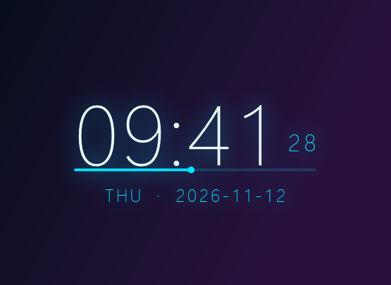
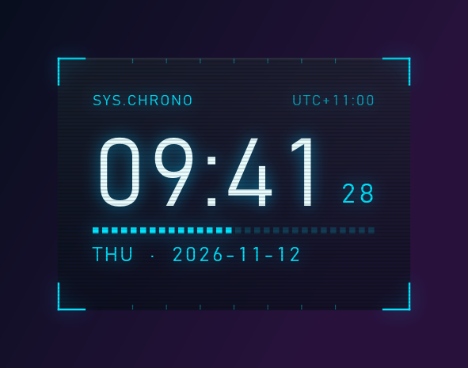
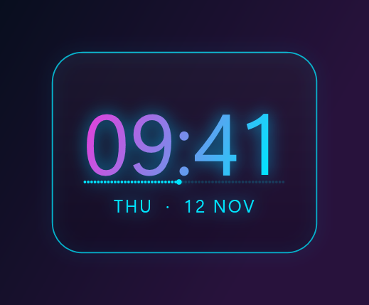
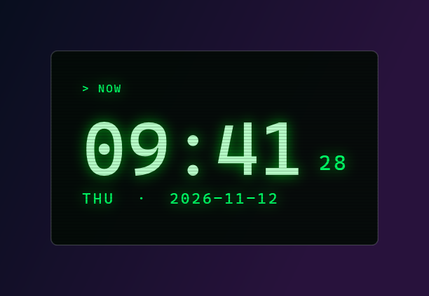
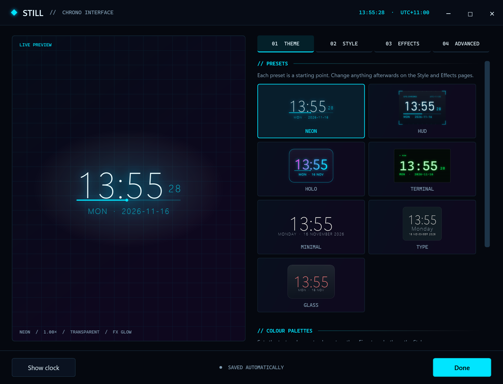

# Still

A futuristic, deeply customizable desktop clock for Windows 11.

Still is an actual borderless WPF desktop widget with a separate settings window
and notification-area menu. C# / .NET 10 LTS; no web view, server, account,
telemetry, network calls, plugins, or administrator privileges.

| Neon | HUD |
| --- | --- |
|  |  |
| **Holo** | **Terminal** |
|  |  |



*Actual WPF renders exported with `Still.exe --capture`. The backdrop behind each clock is illustrative.*

## Install on Windows 11

**[Download the Still installer](https://github.com/danny19862025/still-clock/releases/latest/download/Still-Setup-win-x64.exe)** · [Portable ZIP](https://github.com/danny19862025/still-clock/releases/latest/download/Still-win-x64.zip) · [All releases](https://github.com/danny19862025/still-clock/releases)

1. Exit an older Still from its notification-area clock icon > **Exit Still**. Closing Settings leaves the clock running.
2. Download and run **Still-Setup-win-x64.exe** from the latest release.
3. Follow Setup. Still installs for your Windows user, adds a Start menu shortcut, and offers an optional desktop shortcut.
4. Launch Still and pick a preset such as **Neon**, **HUD**, **Holo** or **Terminal**. Drag the clock to move it; double-click it to open Settings.

The installer includes .NET, requires no administrator privileges, and targets Intel/AMD x64 Windows 11. Preferences remain in `%LOCALAPPDATA%\Still` across upgrades and uninstall. Remove the app using **Windows Settings > Apps > Installed apps > Still > Uninstall**. Uninstall also removes the app's sign-in entry when it points to the installed copy.

The release is unsigned. Checksums are published in **SHA256SUMS.txt** alongside the downloads.

For portable use, extract **Still-win-x64.zip** into a permanent folder and run **Still.exe**. Keep every file together. To update a portable copy, exit Still and replace its files. To remove it, disable launch at sign-in, exit Still and delete its folder.

### Everyday controls

Settings has four pages (**Ctrl+1–4**):

- **01 Theme:** a live gallery of all seven presets, one-click colour palettes, theme sharing (**Copy theme** / **Paste theme**) and **Reset to defaults**.
- **02 Style:** font, weight, size, letter spacing, text and accent colours, time format, seconds, AM/PM, weekday style, date format, uppercase, alignment, scale and widget opacity.
- **03 Effects:** neon glow and its strength, gradient text, seconds indicator, blinking separator, frame, header caption, time-zone tag, surface type and tint, surface opacity, corner radius and CRT scanlines.
- **04 Advanced:** position & startup (lock, click-through, always-on-top, launch at sign-in, display placement) and the optional custom-text template.
- **Notification-area clock icon:** settings, show/hide, unlock and exit. Windows may put the icon under the up arrow.

### Seven starting points

- **Neon** (default): thin glowing digits, a sweeping seconds bar, a blinking colon and an ISO date.
- **HUD:** a scanlined instrument panel with corner brackets, a `SYS.CHRONO` caption, a UTC offset tag and segmented seconds.
- **Holo:** magenta-to-cyan gradient digits in an outlined glass card with a dotted seconds track.
- **Terminal:** glowing green monospace on a solid CRT panel with scanlines and a `> now` prompt.
- **Minimal:** light hours/minutes and date on a transparent surface.
- **Type:** larger time and weekday on a solid dark card.
- **Glass:** a rounded, subtly shaded translucent card with a fine highlight.

A preset is only a starting point; every setting can be changed afterwards.
Palettes (Cyber, Synth, Matrix, Solar, Plasma, Ice, Ember, Classic) set text and
accent colours together. Glow, indicators, frames and the gradient follow the
accent colour. Scanlines appear on Card and Solid surfaces. There is no wallpaper blur.

Fresh installs start on Neon with normal stacking, an unlocked position and login
launch off. Settings files from Still 1.x keep their look: every new effect is off
until you turn it on. Basic customization never needs markup.

**Theme sharing:** *Copy theme* puts a single `still-theme:` line on the clipboard.
*Paste theme* applies one. Themes carry appearance only. Position, lock,
click-through, always-on-top and startup always stay on your PC. Invalid or
oversized themes are rejected, and values are clamped the same way as saved settings.

## Desktop controls

- Drag the unlocked clock to reposition. Drag its lower-right corner to scale;
  the grip appears on hover. Double-click, press **F2** or **Ctrl+,**, or use the
  tray menu to open Settings. Keyboard shortcuts apply while the clock has focus.
- In Settings, **Advanced > Position & startup** contains lock, click-through, always-on-top, startup,
  and buttons to move to each connected display.
- Right-click the **clock icon in the notification area** for Settings,
  Show/Hide, Lock/Unlock, **Unlock and restore interaction**, and Exit.
  Windows may put the icon in the notification-area overflow (the up arrow).
- The explicit restore action disables click-through, unlocks, shows, unminimizes
  and places the clock within a connected display. It always remains available
  from the tray, even when the clock cannot receive mouse input.
- **Always on top** is independent of lock and defaults off. The clock has no
  border, taskbar button, or Alt+Tab entry. Settings has a normal taskbar entry.
- This is a standard top-level window, **not wallpaper embedding**. Other windows
  can cover it; **Win+D / Show Desktop may hide or minimize it**, including with
  always-on-top enabled. Use the tray's **Show clock** or **Unlock and restore
  interaction** to restore it. Pin the tray icon for easier access.
- The saved display and offsets use device-independent units relative to that
  display's working area. Physical monitor origins can be negative. Positions
  are clamped; a disconnected display falls back to the primary display. Oversized
  widgets scale down to fit the working area. The app is Per-Monitor V2 DPI aware.
- Size is content-driven; the font-size and overall-scale choices determine it
  and are saved. There is one clock and one app instance per user session.
- Login launch uses the current user's Windows Run entry, off initially. Settle
  the executable in its permanent folder first. Disable and re-enable after
  moving it. Exit does not remove the startup preference; switch it off before
  deleting the portable app. Windows startup policy can override this preference.

Settings supports Tab/Shift+Tab, Space, arrow keys, labelled controls and access
keys. **Ctrl+1–4** switches Theme/Style/Effects/Advanced. **Reset defaults**
restores appearance and interaction defaults and disables login launch; it keeps
the current position. The tray restore action recovers visibility and interaction.

## Advanced, optional

Enable **Use custom template** in Advanced. Up to three lines and 240 characters;
first line large, others smaller. Insert placeholders using buttons or type:

```text
{time} {ampm}
{weekday}
{day} {month} {year}
```

| Placeholder | Meaning |
| --- | --- |
| `{time}` | Hours/minutes, follows 12/24-hour and seconds settings |
| `{hour}` | Two-digit hour in selected format |
| `{minute}`, `{second}` | Two-digit minute or second |
| `{ampm}` | Regional AM/PM in 12-hour mode, empty in 24-hour mode |
| `{weekday}` | Full regional weekday name |
| `{date}` | Day, full month name and year |
| `{day}`, `{month}`, `{year}` | Two-digit day, full month name, four-digit year |

Placeholders are case-sensitive. All other characters are literal plain text.
Unmatched braces, unknown placeholders, empty text and overlong layouts produce
an inline validation message; the last valid template continues to preview and
save. There is no HTML/CSS subset, scripts, expression evaluation, remote content,
filesystem lookup, command launching, animation, or compatibility layer for Plasma
templates. In Advanced mode the template determines visible text; weekday/date/
AM-PM checkboxes apply to presets. `{time}` still follows seconds and time format.

## Local preferences and timekeeping

`%LOCALAPPDATA%\Still\settings.json` stores appearance, size/scale, display,
position and behaviour. Writes use a temporary file and atomic replacement.
Malformed files are copied to `settings.json.damaged` where possible, then safe
defaults load. Invalid fields are normalized. A save failure leaves session
changes active and displays a status message in Settings. Delete the JSON while
Still is stopped for a fresh start. Startup registration is maintained separately
in your user profile.

The clock samples **DateTime.Now** on each refresh, never increments a counter.
The timer aligns to the next second only when visible seconds require it;
otherwise it aligns to the next minute. With both clock and Settings hidden,
there is no ticking. Windows time, power, regional/timezone and display notifications
refresh/reposition as appropriate. Tray restoration handles Explorer restart.

## Build, test, publish

Use the **.NET 10 SDK**, supported through November 2028. Windows is required
to run WPF; Linux can cross-compile with `EnableWindowsTargeting` (already set).
An internet connection is needed to restore SDK runtime/reference packs during
the build, never to run the app.

```powershell
dotnet run --project tests/Still.Tests -c Release
dotnet run --project src/Still.App -c Release
powershell -ExecutionPolicy Bypass -File scripts/publish.ps1
```

Direct reproducible x64 publish command (from this directory):

```powershell
dotnet publish src/Still.App -c Release -r win-x64 --self-contained true -o artifacts/Still-win-x64 -p:DebugType=None -p:DebugSymbols=false
```

The release folder includes the .NET desktop runtime. Keep all files together for portable use; the installer packages them automatically.

To build the installer, install Inno Setup 6.3+ or 7 and run:

```powershell
./scripts/build-installer.ps1
```

The installer is written to `artifacts/Still-Setup-win-x64.exe`. GitHub Actions tests and packages app changes on main. After bumping the app version, run the Windows release workflow manually to publish a new versioned release.

Do not enable trimming for WPF. For a smaller download on machines with the
.NET 10 **Desktop Runtime** already installed:

```powershell
dotnet publish src/Still.App -c Release -r win-x64 --self-contained false -o artifacts/Still-framework-dependent
```

Tests are a dependency-free executable: any failure returns a nonzero exit code.
They cover time boundaries/localization, safe formatting, adaptive scheduling,
settings round-trips/recovery/write failures and off-screen/mixed-DPI restoration.
See [verification](docs/VERIFICATION.md) for exact verified and unverified scope.

On Windows, run `Still.exe --capture` from a writable release folder to export
**actual WPF renders** of all seven presets and settings into `screenshots/` beside
the executable. This is optional and does not change saved appearance preferences.
Screenshots do not establish native interaction correctness; use the manual
Windows checklist as well.

## Source and attribution

`src/Still.Core` is the platform-independent settings/formatting/placement code.
`src/Still.App` contains the WPF UI, Win32 interaction and tray integration.
`tests/Still.Tests` runs core regression tests on Linux or Windows.

Inspired by [HTML Clock for Plasma](https://github.com/MarcinOrlowski/html-clock-plasmoid).
See [the design review](docs/REFERENCE-REVIEW.md) and
[third-party attribution](THIRD-PARTY-NOTICES.md). No source, templates or visual
assets from that project are copied. Still uses the MIT licence.
